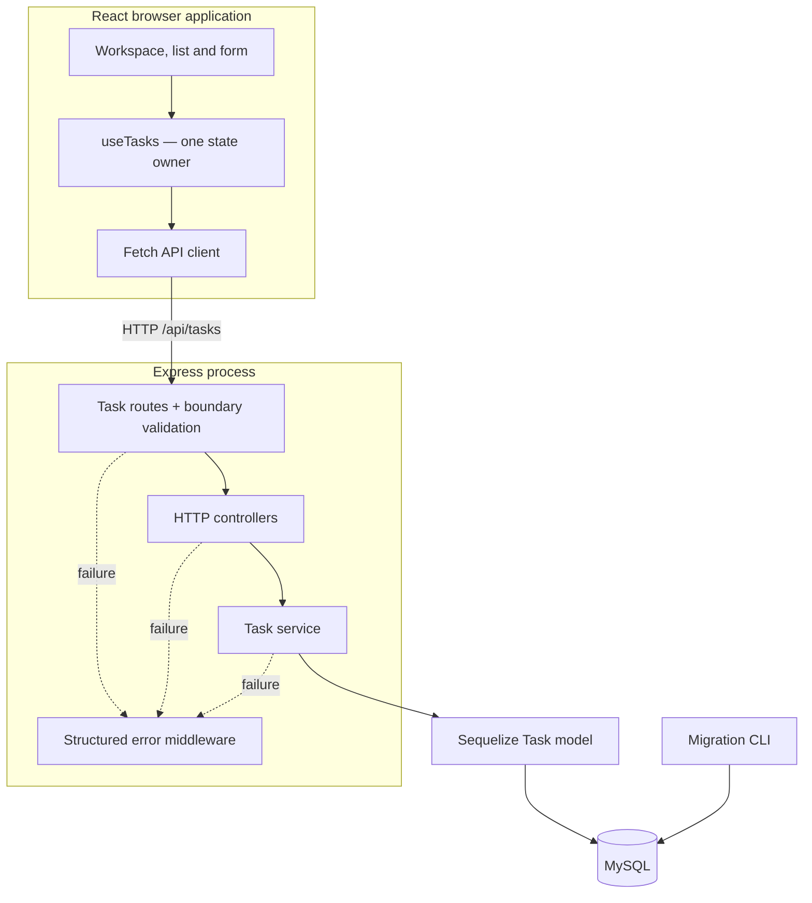
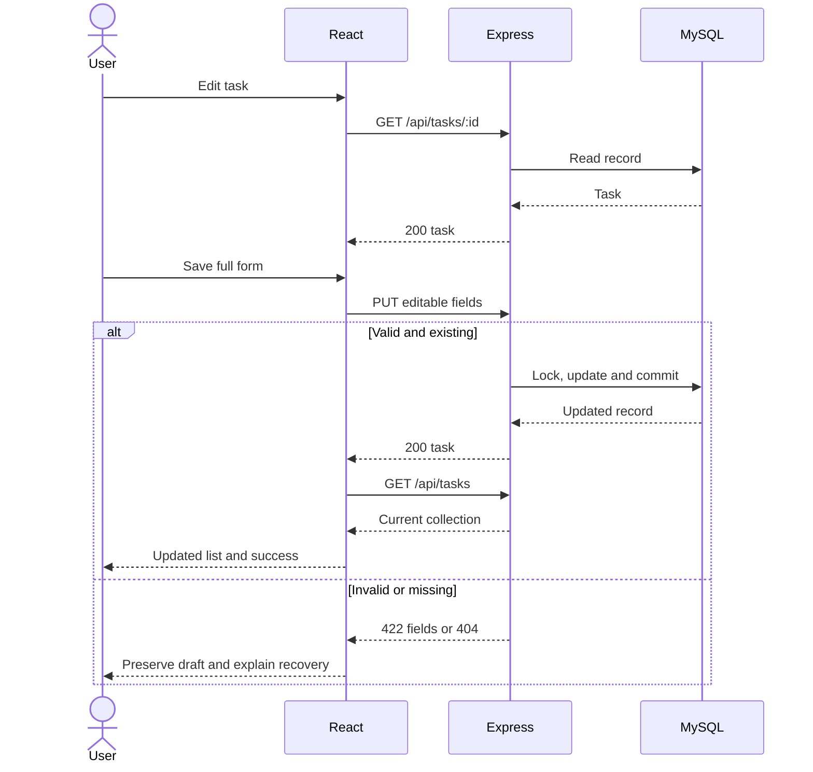

# Taskline — Architecture and Implementation Plan

**Updated:** 16 October 2026  
**Direction:** Desktop-first task workspace; phone cards.  
**Stack:** Node.js 24, Express 5, Sequelize 6, mysql2, MySQL, React 19 and Vite.  
**Scope:** The original assignment's task capabilities and five routes are preserved. Laravel is replaced with Node.js at the user's request. The employer may still evaluate the original Laravel criterion; disclose the substitution in submission.

## 1. Product requirements

| Requirement     | Implementation decision                                                 |
| --------------- | ----------------------------------------------------------------------- |
| Task title      | Required trimmed string, maximum 255 JavaScript string units            |
| Description     | Optional plain text, maximum 5,000 units; blank becomes null            |
| Status          | Exactly Pending, In Progress or Completed; new task defaults to Pending |
| Due date        | Optional real calendar date, YYYY-MM-DD; null means no date             |
| Display tasks   | Desktop table and mobile cards                                          |
| Create / edit   | Inline controlled form above the list                                   |
| Delete          | Explicit native dialog confirmation before the API call                 |
| Update status   | Native status select; uses full PUT, preserving other fields            |
| Filter          | All plus the three statuses; derived from loaded tasks                  |
| API integration | Real HTTP requests and persistent MySQL storage                         |
| Feedback        | Loading skeletons, pending controls, validation and request messages    |
| Project         | One repository containing backend/, frontend/, README.md and .gitignore |

One shared task collection is sufficient. Accounts, roles, priorities, projects, reminders, uploads, Kanban and reporting are outside scope. Duplicate titles and past due dates are valid. Any status can change to any other status. Deletion is permanent. Server state is authoritative; localStorage is not used for task persistence.

## 2. Selected design — Taskline

The user delegated selection to Impeccable. The selected direction is a digital task ledger with an ink navigation rail, warm paper surfaces and sage accents. The product opens directly into the workspace. A clear task list and inline editing supply the visual identity; there is no marketing hero or fabricated dashboard data.

Impeccable Operate principles guide the design: scanability, consistent controls, restrained semantic color, meaningful state feedback and familiar native interactions. Its remote concept catalog was unavailable; this is a grounded local design choice rather than a completed external catalog comparison.

### Composition

| Surface     | Desktop                                               | Phone                                                |
| ----------- | ----------------------------------------------------- | ---------------------------------------------------- |
| Navigation  | Ink rail with All, Pending, In Progress and Completed | Compact brand header with wrapped status navigation  |
| Main header | Tasks, real task count and Add task                   | Stacked heading and full-width primary action        |
| Task list   | Task title/preview, Status, Due date, Actions         | Cards with identical data/actions and visible labels |
| Editing     | Inline form above list                                | One-column form                                      |
| Deletion    | Accessible native dialog                              | Viewport-sized native dialog                         |

The rail's completion count and progress bar derive only from the current loaded collection. All-task counts remain visible while filtering locally. The API also supports optional server filtering and pagination for direct consumers.

### Design tokens

| Token               | Value                                                           |
| ------------------- | --------------------------------------------------------------- |
| Font                | Self-hosted variable DM Sans                                    |
| Type                | 36px main heading; 15–16px body/input; 12–14px compact metadata |
| Canvas / surface    | #F5F7F3 / #FFFFFF                                               |
| Ink / muted         | #202722 / #5D685F                                               |
| Rail / rail text    | #19231E / #E6EDE7                                               |
| Primary fill / text | #BCE3B7 / #203C29                                               |
| Focus               | #326247                                                         |
| Control outline     | #768374                                                         |
| Pending             | #6B551D on #FAF0CF                                              |
| In Progress         | #285D87 on #E6F0F8                                              |
| Completed           | #326247 on #E5F1E3                                              |
| Danger              | #B42318                                                         |
| Spacing             | 4, 8, 12, 16, 24, 32, 48px                                      |
| Radius              | 8px controls; 14px working surface                              |
| Motion              | 160–180ms state transitions; reduced-motion override            |

Opening the inline editor is the signature interaction: details unfold in the working context and Title receives focus. Standard selects, buttons and date inputs remain recognizable. Decorative imagery is unnecessary for the product.

### UI state behavior

| State                 | Presentation / recovery                                                      |
| --------------------- | ---------------------------------------------------------------------------- |
| Initial loading       | Skeleton, aria-busy and loading announcement                                 |
| Empty collection      | Clear first-task invitation                                                  |
| Empty filter          | Named status empty state with View all tasks                                 |
| List failure          | Actionable message and Retry; retain previously loaded rows if available     |
| Form validation       | Keep draft, show linked field errors and focus first invalid input           |
| Saving                | Disable duplicate submissions and conflicting controls                       |
| Status update         | Retain confirmed old value until API succeeds                                |
| Delete                | Name task; Cancel initially focused; focus trapped by native dialog          |
| Delete failure        | Keep dialog open and display the failure inside it                           |
| Success               | Accessible success message; reconcile list and refresh                       |
| Unknown write outcome | Require refresh before another write; do not automatically retry             |
| Long content          | Wrap titles; preview descriptions on desktop; full text accessible in editor |

Target WCAG 2.2 AA semantics, keyboard access, visible focus and non-color-only status. Date values are formatted without UTC conversion. Responsive cards replace the table below 768px. Color/spacing decisions are implemented tokens; a completed browser accessibility audit is not implied.

## 3. HLD — architecture



The browser cannot access database credentials or connect to MySQL. Routes validate external input; controllers translate HTTP; services implement resource operations; the ORM maps persistent records. One database, one process and one business entity are enough. A generic repository layer, microservices and a global frontend store would add unnecessary concepts.

### Runtime topology

| Part                       | Local default                                                    |
| -------------------------- | ---------------------------------------------------------------- |
| Frontend                   | Vite, localhost:5173                                             |
| API                        | Express, 127.0.0.1:3000                                          |
| Database                   | MySQL, 127.0.0.1:3306                                            |
| Frontend/API connection    | Relative /api URL through Vite proxy                             |
| Alternative database setup | Optional compose.yaml with MySQL 8.4 and persistent named volume |

Recommended database target: MySQL 8.4. The schema also uses MySQL 8.0-compatible types and collation. Public deployment is a separate step: the supplied requirements do not include authentication, so this is a shared local/private workspace. A Worker-only hosting runtime cannot directly run the requested Express/TCP-MySQL topology without additional infrastructure.

## 4. LLD — repository and responsibilities

| File / folder                             | Responsibility                                              |
| ----------------------------------------- | ----------------------------------------------------------- |
| README.md                                 | Startup, database setup, API usage and limitations          |
| plan.md                                   | This architecture and implementation roadmap                |
| PRODUCT.md, DESIGN.md                     | Product truth and selected UI direction                     |
| .gitignore                                | Keep environments, dependencies and build output out of Git |
| compose.yaml, .env.example                | Optional local MySQL container configuration                |
| backend/.env.example                      | Backend configuration placeholders                          |
| backend/.sequelizerc, config/database.js  | Migration CLI paths and environment                         |
| backend/migrations/                       | Reversible schema changes                                   |
| backend/scripts/seed.js                   | Optional illustrative demo records on an empty database     |
| backend/src/app.js                        | Middleware/routes; export app without listening             |
| backend/src/server.js                     | Database startup, listening and graceful shutdown           |
| backend/src/config/                       | Validated environment and one shared connection pool        |
| backend/src/models/Task.js                | Field and timestamp mapping                                 |
| backend/src/validators/taskSchemas.js     | Strict body, ID and query parsing                           |
| backend/src/middleware/                   | Validation and safe JSON errors                             |
| backend/src/routes/taskRoutes.js          | Five mandated routes                                        |
| backend/src/controllers/taskController.js | Status codes and response envelopes                         |
| backend/src/services/taskService.js       | CRUD queries and update transaction                         |
| backend/src/utils/                        | Known errors and public serialization                       |
| frontend/src/App.jsx                      | Workspace composition, editor and dialog state              |
| frontend/src/hooks/useTasks.js            | Fetching, mutation coordination and notices                 |
| frontend/src/api/                         | Fetch wrapper, task response parsing and endpoint calls     |
| frontend/src/components/                  | Sidebar, task list, form, feedback and delete dialog        |
| frontend/src/constants/                   | Exact statuses and presentation mapping                     |
| frontend/src/utils/date.js                | Date-only display and overdue derivation                    |
| frontend/src/styles/                      | Reusable CSS tokens and responsive rules                    |

Backend is CommonJS; frontend uses ES modules. Keep file/import casing exact across Windows and Linux. Each application has a committed package-lock.json and uses npm ci for reproducible installation.

## 5. LLD — database

| Column      | Type                                      | Rule                            |
| ----------- | ----------------------------------------- | ------------------------------- |
| id          | INT UNSIGNED AUTO_INCREMENT               | Primary key                     |
| title       | VARCHAR(255)                              | Required                        |
| description | TEXT                                      | Nullable                        |
| status      | ENUM('Pending','In Progress','Completed') | Required; Pending default       |
| due_date    | DATE                                      | Nullable, no timezone           |
| created_at  | DATETIME(3)                               | Server-created UTC timestamp    |
| updated_at  | DATETIME(3)                               | Server-maintained UTC timestamp |

Use InnoDB, utf8mb4 and utf8mb4_0900_as_cs collation. Add an index on (status, id). Default sort is id DESC. The Task model uses DATEONLY for due_date, maps timestamps to snake_case and has no soft delete. SequelizeMeta records applied migrations.

Run migrations explicitly; never use force sync or schema alteration on startup. The optional seed inserts six clearly illustrative tasks only when the collection is empty. It does not erase user records or run automatically.

Validate actual calendar days, leap years and MySQL's supported date range 1000-01-01 to 9999-12-31. Null clears an optional value. Blank description normalizes to null. A blank browser date becomes null before the request; an empty API date string is invalid.

## 6. LLD — API contract

Task JSON contains id, title, description, status, due_date, created_at and updated_at. Timestamp values are UTC ISO strings; due_date is YYYY-MM-DD or null. Metadata is read-only.

| Route                 | Request                                                | Success                               |
| --------------------- | ------------------------------------------------------ | ------------------------------------- |
| GET /api/tasks        | Optional status, page and pageSize query               | 200; array plus metadata              |
| POST /api/tasks       | Required title; optional description, status, due_date | 201; created task and Location header |
| GET /api/tasks/:id    | Positive canonical integer ID                          | 200; one task                         |
| PUT /api/tasks/:id    | All four editable keys                                 | 200; updated task                     |
| DELETE /api/tasks/:id | ID                                                     | 200; deleted id                       |

Full PUT requires title, description, status and due_date. Optional values may be null, but their keys must be present. There is no extra PATCH or status route. The inline status selector sends the full editable record with just status changed.

Bare GET returns all records. status filters exactly and is case-sensitive. If page or pageSize is provided, defaults for the omitted counterpart are 1 and 20. pageSize maximum is 100. Unpaginated metadata uses null pagination values. Paginated totalPages is ceil(total/pageSize), including 0 for no results. Beyond-last-page results are an empty array. Repeated/unknown query keys are invalid.

### Success envelopes

```json
{
  "success": true,
  "message": "Task created successfully.",
  "data": {
    "id": 1,
    "title": "Prepare the handoff",
    "description": null,
    "status": "Pending",
    "due_date": "2026-10-20",
    "created_at": "2026-10-16T00:00:00.000Z",
    "updated_at": "2026-10-16T00:00:00.000Z"
  }
}
```

List data is an array, with meta containing total, page, pageSize and totalPages. Deletion data is an object with id. An empty list is a successful 200 response.

### Errors

```json
{
  "success": false,
  "error": {
    "code": "VALIDATION_ERROR",
    "message": "Please correct the highlighted fields.",
    "fields": { "title": ["Task title is required."] }
  }
}
```

| HTTP | Error code                       | Meaning                               |
| ---- | -------------------------------- | ------------------------------------- |
| 400  | INVALID_JSON / INVALID_TASK_ID   | Malformed body or invalid ID          |
| 404  | TASK_NOT_FOUND / ROUTE_NOT_FOUND | Missing record or route               |
| 413  | PAYLOAD_TOO_LARGE                | JSON exceeds 64 KiB                   |
| 415  | UNSUPPORTED_MEDIA_TYPE           | POST/PUT needs application/json       |
| 422  | VALIDATION_ERROR                 | Fields or query values are invalid    |
| 500  | INTERNAL_ERROR                   | Safe generic internal failure         |
| 503  | DATABASE_UNAVAILABLE             | Recognized connection or pool failure |

Reject unknown body properties and caller-controlled IDs/timestamps. Return fields as an empty object for non-field failures. Never expose SQL, stack traces or credentials. Responses include X-Request-Id and Cache-Control: no-store.

## 7. LLD — backend processing

Middleware order: request ID/logging, security headers, configured CORS, bounded JSON parsing, task routes, unknown-route handler and centralized four-argument error handler. Express 5 async handlers return/await their promises.

| Service method   | Algorithm                                                                                |
| ---------------- | ---------------------------------------------------------------------------------------- |
| list(query)      | Build validated where/order; findAndCountAll; optional offset/limit; serialize           |
| get(id)          | findByPk; null becomes 404                                                               |
| create(input)    | Create allowlisted editable fields and serialize                                         |
| update(id,input) | Transaction; SELECT FOR UPDATE; missing row 404; update; return committed representation |
| remove(id)       | Atomic destroy by ID; zero removed rows becomes 404                                      |

The update lock prevents a delete-between-read-and-update race. It does not detect a stale browser form: concurrent tabs use last successful write wins. An unchanged valid PUT is still successful. Repeated DELETE returns 404.

The database connection is authenticated before the server listens. One pool has max 5 connections and a 10-second acquire timeout. Startup errors are redacted. SIGINT/SIGTERM drain requests and close Sequelize, with a bounded shutdown deadline.

## 8. LLD — frontend state and data flow

| State                            | Responsibility                                               |
| -------------------------------- | ------------------------------------------------------------ |
| tasks                            | Last successful all-task API snapshot                        |
| phase / refreshing / listError   | Initial load and later refresh state                         |
| filter                           | All or one exact status; visible records are derived         |
| editor / editLoading / editError | Create/edit context and GET-one prefill                      |
| deleteTarget / deleteError       | Confirmed task identity and visible dialog recovery          |
| busy                             | One current mutation with kind and ID                        |
| notice                           | Accessible success/error feedback                            |
| needsRefresh                     | Unknown write outcome; block writes until successful refresh |

useTasks owns server state. App owns presentation context. One synchronous mutation lock prevents duplicate requests even before React rerenders. Superseded reads are aborted and guarded by a request sequence. Unmount cleanup cancels reads; development Strict Mode remains safe.

On Edit, fetch the single-task resource before showing the form. On Save, normalize and send only editable fields. On success, reconcile local records, show success, close the form/dialog and refresh the collection. A failed refresh does not turn a successful write into a failed write. Status filtering remains selected and recomputes from the reconciled collection.

The fetch wrapper checks HTTP status and response envelopes, applies a 15-second timeout and maps field errors. A timed-out write may already have committed: do not retry automatically. Require a successful refresh before another write. Preserve drafts on failure.



## 9. Correctness and configuration boundaries

Use strict input schemas, ORM parameters and fixed ordering. Render user text through React text nodes. Keep database credentials in backend .env only; VITE\_\* variables are public. Configure CORS to the known frontend origin; it is not authentication.

Use a local database account scoped to task_management. Migrations require DDL privileges; deployments can use a separate migration account and limit the long-running application account to CRUD. Bind the local database and API to loopback unless deliberately setting up trusted device access.

Ignore environments, dependency folders and generated builds in Git. Commit lockfiles, source and migrations. No credential values or database data belong in the source archive.

## 10. Implementation roadmap

| Stage         | Deliverable                                                        | Completion condition                                              |
| ------------- | ------------------------------------------------------------------ | ----------------------------------------------------------------- |
| Foundation    | Monorepo structure, dependency manifests and environment examples  | Both projects install; Git exclusions are correct                 |
| Persistence   | Task migration, model and optional demo seed                       | MySQL migration and record round-trip work                        |
| API           | Five routes, validation, errors and transactions                   | Direct HTTP CRUD behaves as specified                             |
| Workspace     | Desktop rail/table, mobile cards and inline form                   | Every original task action connects to the API                    |
| Recovery      | Request cancellation, write locks, notices and delete confirmation | Failures preserve context and expose useful recovery              |
| Design finish | DM Sans, semantic palette, responsive CSS and native controls      | Build succeeds; mechanical design checks reviewed                 |
| Handoff       | README, revised plan and source archive                            | Installation is documented; secrets/dependencies are excluded     |
| Submission    | GitHub remote and candidate details                                | Actual account/repository are supplied before external submission |

Use meaningful commits for foundation, API, workspace and setup/documentation. Keep work reviewable; do not fabricate repository URLs or email completion. Candidate name, GitHub destination and actual submission date remain external details.

## 11. Setup specification

Backend variables: NODE_ENV, HOST, PORT, DB_HOST, DB_PORT, DB_NAME, DB_USER, DB_PASSWORD and FRONTEND_ORIGIN. Frontend variable: VITE_API_BASE_URL, normally /api. The Vite proxy points /api to 127.0.0.1:3000; update that target when deliberately changing the backend port.

Start MySQL, copy environment examples, install each app with npm ci, run npm run db:migrate in backend, optionally run npm run db:seed, then start backend and frontend in separate terminals. Use npm run build for the production frontend bundle. README supplies separate Windows and POSIX environment-copy commands and both existing-MySQL and Docker setup options.

## 12. Delivery limits

Build and direct API behavior are checked during implementation. A browser visual/accessibility inspection is only claimed when the environment supplies the required browser capability. MySQL data and generated .env values are local runtime state and excluded from deliverables.

Public hosting, GitHub account selection and email submission are not implied by creating the source archive. Preserve the required backend/frontend structure and disclose the Node.js substitution.

## References

- [Express error handling](https://expressjs.com/en/guide/error-handling/)
- [Sequelize migrations](https://sequelize.org/docs/v6/other-topics/migrations/)
- [Sequelize MySQL setup](https://sequelize.org/docs/v6/getting-started/)
- [MySQL date/time types](https://dev.mysql.com/doc/refman/8.4/en/date-and-time-types.html)
- [Vite guide](https://vite.dev/guide/)
- [WCAG 2.2 reference](https://www.w3.org/WAI/WCAG22/quickref/)
